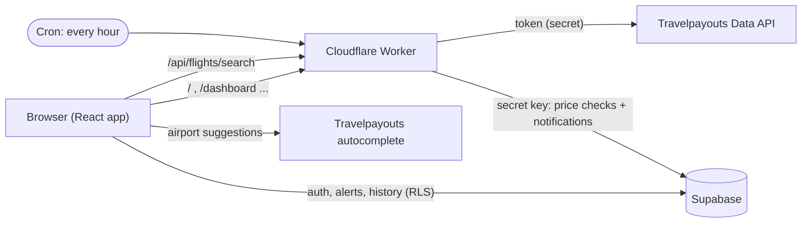

# ✈️ FlyAlert

**Track flight prices worldwide and get notified when they drop to your target price.**

FlyAlert is a free flight price tracking web app. Search a route, set a target price, and FlyAlert checks the fare automatically and notifies you when it drops. FlyAlert does not sell tickets: you book directly with the airline or booking site.

🔗 **Live:** https://flyalert.slaydirella.workers.dev

---

## Features

- **Flight search:** worldwide airport and city search (e.g. `LON` = all London airports), one-way or round-trip, up to 9 passengers
- **Real fares** from Aviasales via the Travelpayouts Data API, with exact-date and **nearby-date (±3 days)** results
- **Filters and sorting:** stops, price, departure time, flight duration, airline; Best / Cheapest / Fastest
- **Price alerts:** create, edit target price, pause, resume and delete; flexible dates (±0–3 days); up to 5 active alerts per user
- **Automatic price checks:** a scheduled job checks active alerts about every 6 hours
- **Price history** chart (plus an accessible table view) and comparison: latest fare, change since the last check, lowest so far, distance to target
- **In-app notifications** when a fare reaches the target, with protection against repeated notifications for the same price
- **Accounts:** sign up, log in, password reset, preferred currency and language
- Responsive, accessible UI (keyboard and screen reader friendly), dark-mode-ready design tokens

## Honest data

FlyAlert never invents prices:

- Fares come from a **cache of searches made by Aviasales users in the last ~48 hours**. They may change, and the final price is always confirmed on the booking site.
- For each route and day the data source returns the **cheapest fares found**, not every flight of every airline.
- Prices are **economy fares per adult**.
- Price history only contains prices that were **actually recorded**. Failed checks are stored as errors and can never appear as a price (enforced by a database constraint).
- A clearly labelled **demo mode** exists for development (`VITE_FLIGHT_DATA_SOURCE=demo`). If the real API fails, the app shows an error; it never falls back to demo data.

## Tech stack

| Area | Technology |
|---|---|
| Frontend | React 19, TypeScript, Vite, Tailwind CSS v4, React Router, Recharts, Lucide icons |
| Backend | Cloudflare Workers (API + static assets + Cron Triggers) |
| Database & auth | Supabase (PostgreSQL, Row Level Security, Auth) |
| Flight data | Travelpayouts / Aviasales Data API |
| Testing | Vitest (unit tests), PGlite (database/RLS tests during development) |

## Architecture

One Cloudflare Worker serves the website, the API and the scheduled price checks on a single domain.



More details (data model, security model, price check flow): [docs/architecture.md](docs/architecture.md)

## Project structure

```
FlyAlert/
├── src/                      React app
│   ├── app/                  router
│   ├── components/           shared UI (layout, form fields, buttons)
│   ├── features/             code grouped by feature
│   │   ├── search/           search form, results, filters, API client, demo data
│   │   ├── alerts/           alerts, price history chart
│   │   ├── notifications/    notification bell
│   │   ├── auth/             auth context, route guards
│   │   ├── account/          account settings
│   │   └── landing/          landing page sections
│   ├── layouts/  pages/  lib/
├── worker/                   Cloudflare Worker (API + cron)
│   └── src/                  validation, Travelpayouts client, price checks, Supabase client
├── supabase/migrations/      database schema (SQL)
├── public/_headers           security headers (CSP etc.)
└── docs/                     documentation
```

## Getting started

### Prerequisites

- Node.js 22.22+ (LTS recommended) and npm
- A free [Supabase](https://supabase.com) project
- A free [Travelpayouts](https://www.travelpayouts.com) account (API token)
- A free [Cloudflare](https://dash.cloudflare.com/sign-up) account (only for deployment)

### 1. Install

```bash
git clone https://github.com/rahila-m/FlyAlert.git
cd FlyAlert
npm install
npm --prefix worker install
```

### 2. Database

In the Supabase dashboard → **SQL Editor**, run the files in `supabase/migrations/` **in order** (oldest first).

Then in **Authentication → URL Configuration**, set the Site URL and add your app URLs to Redirect URLs (e.g. `http://localhost:5173/**`).

### 3. Environment variables

Frontend: copy `.env.example` to `.env.local` and fill in your Supabase project URL and **publishable** key.

Worker: copy `worker/.dev.vars.example` to `worker/.dev.vars` and fill in your Travelpayouts token and Supabase **secret** key.

> ⚠️ Never commit `.env.local` or `.dev.vars`, and never put the Supabase secret key in the frontend. Both files are ignored by Git.

### 4. Run locally (two terminals)

```bash
npm run dev:api   # Worker (API + cron) on http://127.0.0.1:8787
npm run dev       # React app on http://localhost:5173 (proxies /api to the Worker)
```

To trigger the scheduled price checks locally:

```bash
curl "http://127.0.0.1:8787/__scheduled?cron=0+*+*+*+*"
```

## Scripts

| Command | Description |
|---|---|
| `npm run dev` | Start the React app (Vite) |
| `npm run dev:api` | Start the Worker locally |
| `npm run build` | Type-check and build the React app |
| `npm test` | Run all unit tests (frontend + Worker) |
| `npm run lint` | Lint with oxlint |
| `npm run deploy` | Build and deploy everything to Cloudflare |
| `npm --prefix worker run typecheck` | Type-check the Worker |

## Deployment

```bash
cd worker
npx wrangler login                            # once: connect Wrangler to your Cloudflare account
npx wrangler secret put TRAVELPAYOUTS_TOKEN   # once
npx wrangler secret put SUPABASE_SECRET_KEY   # once
cd ..
npm run deploy                                # build + deploy website, API and cron
```

After the first deploy, add the production URL to Supabase **Site URL** and **Redirect URLs**.

## Security

- **Row Level Security** on every table: users can only read and change their own data. Column-level grants limit what can be changed (e.g. users cannot raise their own alert limit).
- Secrets (Travelpayouts token, Supabase secret key) exist **only on the server** (Worker secrets). The browser only receives the public Supabase publishable key.
- Strict **Content-Security-Policy** and other security headers (`public/_headers`).
- All API input is validated on the server; booking links are restricted to the booking site's domain; open redirects are blocked.

## Free, and how it's funded

FlyAlert is free for everyone, with no paid plans. Future revenue is planned through affiliate commissions from booking sites (at no extra cost to users) and clearly marked ads.

## Roadmap

- Email notifications (requires an own domain for the email provider)
- Affiliate tracking on booking links
- Turkish and other languages
- Dark mode toggle
- AI-based price insights (only on real recorded data, without claiming to predict future prices)
- Mobile app
