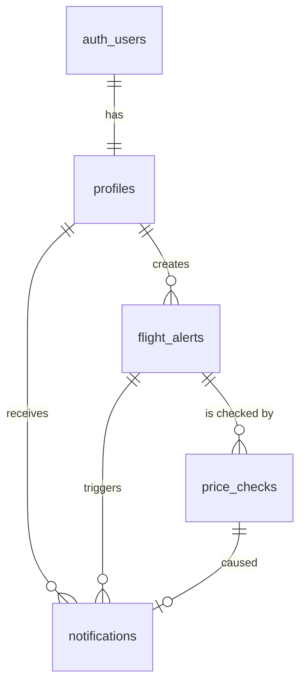

# FlyAlert architecture

This document explains how FlyAlert works under the hood: components, data model, security model and the price check flow.

## Components

| Component | Where | Responsibility |
|---|---|---|
| React app | `src/` | UI: search, results, alerts, dashboard, account. Talks to Supabase directly for user data (protected by RLS) and to the Worker for flight data |
| Cloudflare Worker | `worker/src/` | Serves the built website (static assets), the `/api` endpoints and the hourly price checks (cron) |
| Supabase | `supabase/migrations/` | PostgreSQL database, authentication, Row Level Security |
| Travelpayouts Data API | external | Cached fares found by Aviasales users (last ~48 hours) |
| Travelpayouts autocomplete | external | Airport and city suggestions (public, no token) |

### Why one Worker?

The website, API and cron run in a single Worker on a single domain. Requests to `/api` are same-origin, so no CORS setup is needed in production and the Content-Security-Policy can stay strict (`connect-src 'self'`). Static asset requests are free on Cloudflare's Free plan.

## API

| Endpoint | Description |
|---|---|
| `GET /api/health` | Health check |
| `GET /api/flights/search?from=IST&to=LON&depart=2026-12-10&return=2026-12-17&adults=1&currency=USD` | Fares for a route. Returns offers within ±3 days of the requested dates, each marked `exact` or `nearby` |

Errors always have the shape `{ "error": { "code", "message", "details?" } }`. Identical searches are cached for 10 minutes.

### How a search is built

The flight data API returns only the **cheapest fare per day** and exact-date queries are often empty. The Worker therefore:

1. requests the **whole month** of the departure date (and return date),
2. requests it a second time for **direct flights only**, which usually adds a different airline per day,
3. merges and de-duplicates the results, keeps flights within ±3 days, and marks each one as `exact` or `nearby`,
4. maps airline codes to names (`worker/src/data/airlines.json`, generated by `npm --prefix worker run update-airlines`).

## Data model

| Table | Purpose | Notes |
|---|---|---|
| `profiles` | One row per user: preferred currency and language, `max_active_alerts` | Created automatically by a trigger on sign-up |
| `flight_alerts` | A route + dates to track, with a target price and `flexible_days` (0–3) | A trigger enforces the active alert limit |
| `price_checks` | One row per check attempt: `success`, `no_results` or `error` | A CHECK constraint allows a price **only** on `success` rows; `data_source` is `api` or `demo` |
| `notifications` | Price drop notifications (`in_app`; `email` reserved for later) | A unique index prevents duplicates for the same alert, channel and price |

## Security model

Two layers protect user data:

1. **Row Level Security (which rows):** every table has RLS enabled. Logged-in users can only see and change their own rows; visitors without a session get no access at all.
2. **Column privileges (which columns):** users can only update specific columns, for example `preferred_currency` and `preferred_language` on `profiles`, `target_price` and `is_active` on `flight_alerts`, and `read_at` on `notifications`. They cannot write `price_checks` or notifications at all.

The Worker uses the Supabase **secret key** (bypasses RLS) only for the scheduler, and `worker/src/supabase.ts` exposes only the operations it needs (principle of least privilege).

Other measures:

- Secrets live in Worker secrets (`wrangler secret put`) and in the git-ignored `worker/.dev.vars` locally. The browser bundle is checked to contain no secrets.
- Security headers in `public/_headers`: Content-Security-Policy, HSTS, X-Frame-Options, Referrer-Policy, Permissions-Policy.
- Server-side validation of all search parameters; booking links are only built from relative paths on the booking site; login redirects only allow paths on our own site.

## Price check flow (cron)

Runs every hour (`0 * * * *`):

1. Pause alerts whose departure date has passed.
2. Load up to 9 active alerts whose last check is older than 6 hours (oldest first).
3. For each alert:
   - fetch fares and keep those within the alert's `flexible_days` window,
   - store a `price_checks` row (`success` with the cheapest fare, `no_results`, or `error` with an error code),
   - if the fare is at or below the target **and** lower than any price already notified, create an in-app notification,
   - set `last_checked_at`.
4. If the flight data provider rate-limits us, stop and continue in the next run.

The batch size keeps each run under the Free plan limit of 50 outgoing requests (up to 5 per alert).

## Testing

- `npm test` runs unit tests for search parameters, filters and sorting, demo data, auth helpers, price history, Worker validation, offer mapping, price checks and the notification rule.
- Database migrations and RLS rules were tested locally with PGlite (in-memory PostgreSQL) before being applied to Supabase.
